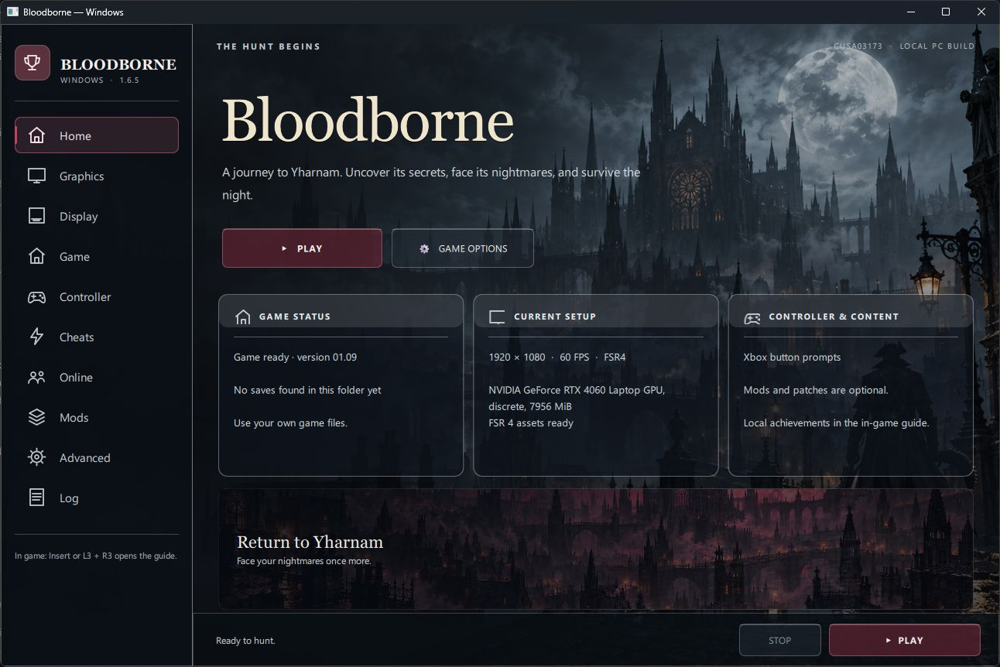
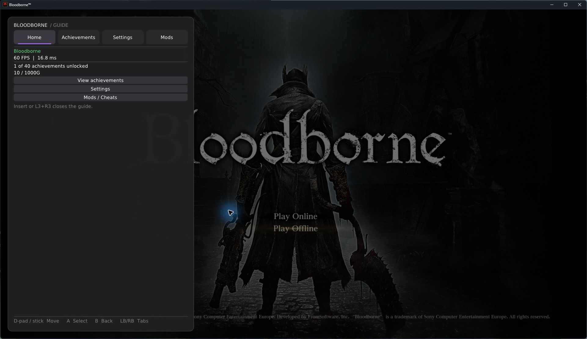
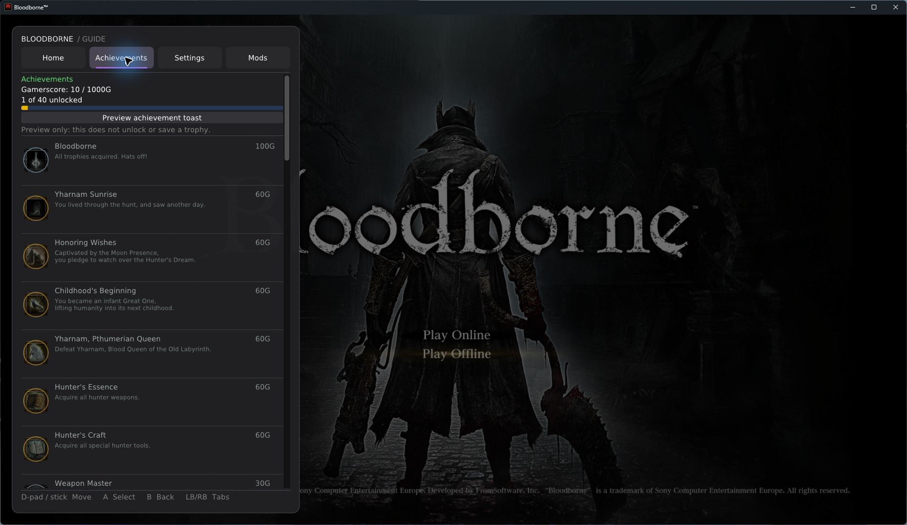
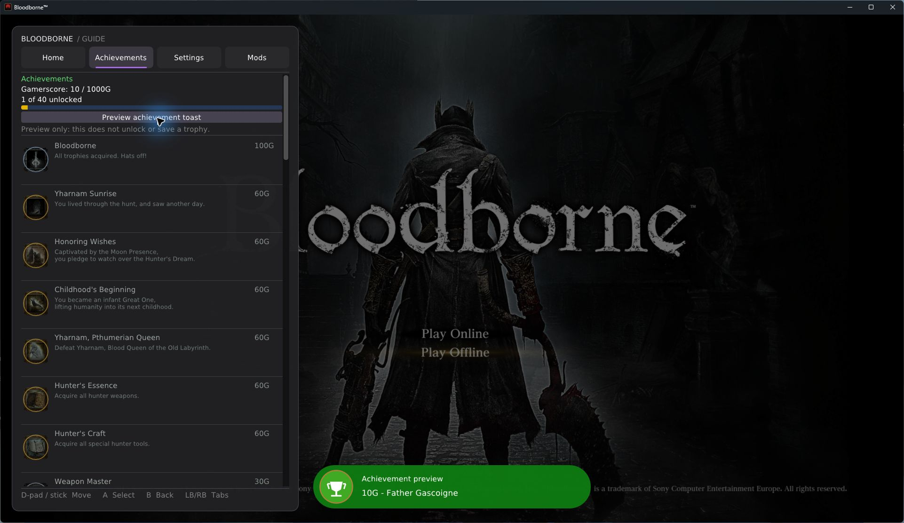
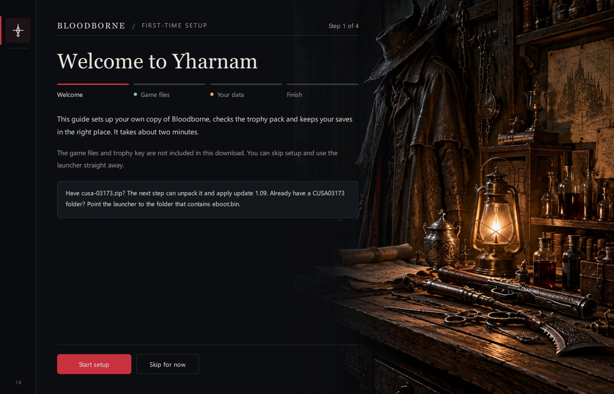
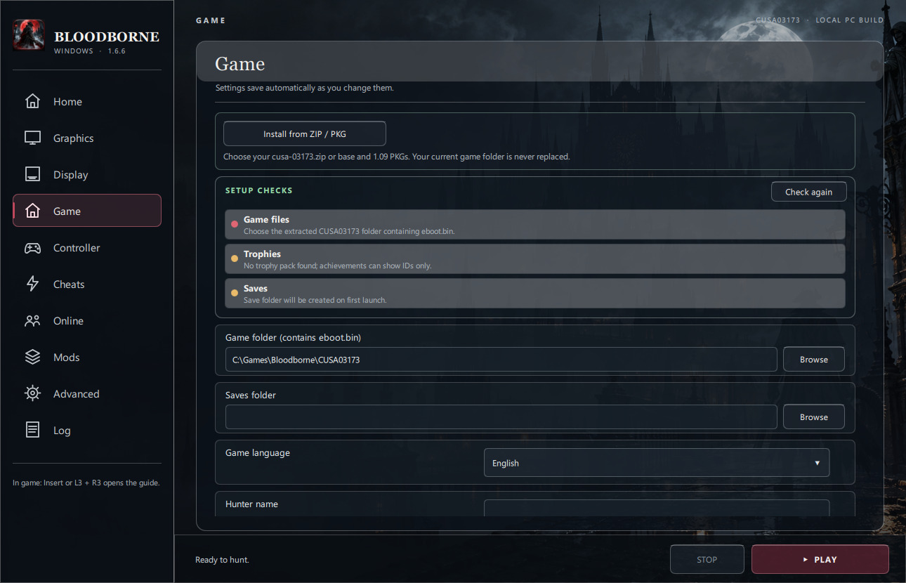

# Bloodborne for Windows — Jgamrot fork

This fork is based on [Supermedo's Windows port](https://github.com/Supermedo/bloodborne_pc),
created by Mohammed Albarghouthi. It runs your own decrypted Bloodborne game files natively
on Windows 10 or 11. It builds on [deadinside28's bbport](https://github.com/deadinside28/bloodborne_pc)
and the [shadPS4](https://github.com/shadps4-emu/shadPS4) renderer.

## Launcher

The Windows launcher is built with Qt Quick. Its dark glass sidebar, cards and settings panels
sit over the included Yharnam artwork. The sidebar opens graphics, display, game, controller,
cheats, online, mods, advanced and log settings. Your settings still use the existing
`settings.json`, `bbport.ini`, `mods.json` and `patches.json` files. The cards show the game
version, save status, graphics card, output settings and selected button prompts.
**Game Options** opens graphics settings. The classic launcher remains available with
`Bloodborne.exe --classic-launcher` if you need it.



## In-game guide and achievements

Press **Insert** on a keyboard or **L3+R3** on a controller while the game is running to open
the guide. **Home** shows FPS and achievement progress; **Achievements** lists locally earned
trophies and Gamerscore; **Settings** and **Mods** contain the existing graphics and cheat
controls. Press the same shortcut to close it. These screenshots show the guide running
over the game at 1440p:

The **Mods** tab can switch between the bundled Xbox prompt pack and the game's original
PlayStation buttons. Choose a style, then select **Apply mods and restart**. The same button
applies gameplay patch changes. Other loose-file mods and their load order remain in the
launcher's **Mods & patches** page.



The Achievements tab shows your locally earned trophies, their icons and dates, and a 1000G
score when your own trophy key is available:



When a trophy unlocks, a green achievement toast appears at the bottom of the game. Unlocks
are queued, so one toast finishes before the next appears:



To check the toast without earning a trophy, open **Achievements** and click **Preview
achievement toast**. It is labelled *Achievement preview* and does not change your unlocks
or save file. Real unlocks say *Achievement unlocked*.

## Which download do I click?

On the [latest release](https://github.com/Jgamrot/bloodborne_pc/releases/latest),
download **[bbport-windows.zip](https://github.com/Jgamrot/bloodborne_pc/releases/latest/download/bbport-windows.zip)**.
It contains the launcher, game executable, Xbox button prompts and PKG extractor. Extract the whole archive.
The two **Source code** downloads are for developers; they are not the game.
None of these downloads includes Bloodborne's game files, saves or a trophy key.

The packaged launcher reached the title screen on Windows. Trophy-key import still needs
wider testing; you can also place your own `keys.json` in `bbport-windows\user` manually.

## First-time setup

1. Right-click **bbport-windows.zip** in Downloads and choose
   **Extract All**. Put the resulting `bbport-windows` folder somewhere you want to keep it,
   such as `C:\Games\Bloodborne\bbport-windows`. Do not run the game from inside the zip.
2. Open `bbport-windows` and double-click **Bloodborne.exe**. On a new install, the setup wizard
   opens automatically. Click **Continue** to follow it, or **Skip setup** to use the normal
   launcher. You can reopen the wizard later from **Game → Setup wizard**.
3. In the wizard's **Game** step (or the launcher's **Game** page), if you have `cusa-03173.zip`,
   click **Install from ZIP / PKG**, choose that ZIP, then choose
   a destination such as `C:\Games\Bloodborne`. The launcher extracts the base game and
   the *plain* 1.09 update and creates `CUSA03173` there. It will not replace an
   existing `CUSA03173` folder. Keep it open until it says the game
   is installed. For a 30 GB archive, allow about 70 GB of free space during setup. The ZIP
   and your other game folders are not changed.
4. If you already have an extracted game folder with `eboot.bin` directly inside it, skip the
   install button. In the wizard click **Choose existing game folder**, or beside **Game folder**
   click **Browse**, and choose that folder. Do not
   select `eboot.bin`, the ZIP, a `.pkg`, or the `bbport-windows` folder.
5. On **Your data**, optionally import your own `keys.json` or choose an existing saves folder.
   Look at the wizard's checks or **Setup checks** on the Game page. **Game files** should turn
   green when the selected folder has version 1.09. **Trophies** checks the pack and key format;
   trophy-name decryption is confirmed only after the game reads the pack. **Saves** checks that
   the folder is writable and whether a Bloodborne save exists. Amber is normal for a new
   install with no saves yet. Click **Check again** after changing files.
6. Finish the wizard and click **Play now**, or click **PLAY** in the launcher. The first launch
   prepares files and may take a while. New areas may stutter
   briefly while shaders are built. After setup, `Play Bloodborne.exe` starts the game using
   your saved settings without opening the launcher.





For example, this folder layout works:

```text
C:\Games\Bloodborne\
├── bbport-windows\
│   ├── Bloodborne.exe
│   └── bin\bb-probe.exe
└── CUSA03173\                 ← choose this as Game folder
    ├── eboot.bin
    ├── dvdroot_ps4\
    ├── sce_module\
    └── sce_sys\
```

The finished folder should contain `eboot.bin`, `dvdroot_ps4`, `sce_module`, and `sce_sys`.
If the launcher says **No eboot.bin**, you chose the wrong folder. If it reports version 1.00,
the 1.09 update did not apply. The installer uses the independently licensed
[ShadPs4Plus PKG Extractor 1.1](https://github.com/AzaharPlus/shadPS4Plus/releases/tag/PKG_EXTRACTOR_1_1)
bundled in this release; the game's own files are never uploaded to this repository.

## Already have another launcher or a working game installation?

You can use the game files you already extracted. **Do not download or extract them again.**
The easiest way to switch is to keep your old launcher folder intact and install this
fork's full package in a **new** folder:

1. Close the game and your old launcher. Find the existing game folder that has `eboot.bin`
   directly inside it. Leave that folder where it is.
2. Back up your old launcher folder, especially its `user` folder (saves, trophies, and any
   `keys.json`), `bbport.ini`, and `mods` folder if present.
3. Download the **full Windows package** above, extract it to a new permanent folder, and
   run its `Bloodborne.exe`. Do not copy only `Bloodborne.exe` into an older port: it needs
   the matching `bin`, scripts, patches, and support files from this package.
4. In **Game**, set **Game folder** to your *existing* folder containing
   `eboot.bin`. Set **Saves folder** to your existing `user` folder if you want to keep those
   saves, or use the new default `user` folder and copy your backed-up save files into it
   while the launcher and game are closed. Keep a backup until the saves load successfully.
5. If you used mods, copy only the mods you still want into the new `mods` folder and
   enable them under **Mods & patches**. Click **PLAY** and confirm your character loads.

This works for Supermedo's launcher and other bbport-derived launchers that use the same
extracted game folder. A separate shadPS4 installation can use the same game files, but its
save layout may differ; keep the old saves backed up and check the new launcher's **Saves
folder** before copying anything. The package includes Xbox button prompts, on by default;
switch between Xbox and original PlayStation buttons on the launcher's **Controller** page.

## What's changed

- Optional PC enhancements, ported from droogie's [bbhost](https://github.com/droogie/bbhost),
  off by default (the game as it shipped). Switch them on in the launcher's **Game** page or the
  in-game menu's **PC enhancements**; they apply after a restart and are made from your own game
  files, which stay unchanged.
  - **Hunter's Dream mirror** (`pc_mirror_appearance`, `BB_PC_MIRROR=1`): the workshop's mirror
    opens the appearance editor, the developers' unused "Put on Disguise".
  - **Two invaders** (`pc_two_invaders`, `BB_PC_TWO_INVADERS=1`): Mensis, Mergo's Loft, the
    Nightmare Frontier and the Old Hunters' areas allow two invaders, as the chalice dungeons
    do. Every player in a session needs it on.
- The in-game settings menu (Insert or L3+R3) is in English, using the translation proposed
  in [upstream PR #13](https://github.com/Supermedo/bloodborne_pc/pull/13).
- Menu checkboxes and sliders save the value you selected, from
  [upstream PR #19](https://github.com/Supermedo/bloodborne_pc/pull/19).
- A v1.6.1 executable passed our fresh character-creation test: the preview appeared and the
  character looked right in the game on one RTX 4060 Laptop GPU at 1440p with DLSS. The
  v1.6.6 executable has not repeated that character-creation test. The earlier preview
  problem's cause remains unisolated.
- The full package has a launcher that checks this fork for updates.
- The 1.6.7 package includes the Xbox button prompts (every build now packages them from
  `packaging/windows/mods`). Its updater adds them to an existing installation if that mod
  folder is missing, while leaving existing mods and settings alone.
- Death respawns no longer wait for the game's fixed 12-second minimum. Asset and character
  readiness checks still apply. This is on by default for supported CUSA03173 1.09 images;
  set `BB_RESPAWN_DELAY_FIX=0` in the launcher's Advanced environment overrides to restore
  the original delay. The fix is adapted from
  [AwesomeObserver's Windows work](https://github.com/AwesomeObserver/bloodborne_pc/blob/windows/docs/respawn-loading-windows.md).
- Shader preload now reuses already loaded shader modules before reading their binaries again,
  and creates the Vulkan pipeline cache before warmup. This removes redundant startup work;
  gameplay FPS gains have not been measured. See [technical notes](docs/respawn-performance-windows.md).
- Motion vectors now keep images for several render sizes instead of draining the GPU whenever
  a scene switches sizes. This addresses the [water-area slowdown reported upstream](https://github.com/deadinside28/bloodborne_pc/issues/30).
  The fix is adapted from [deadinside28's port](https://github.com/deadinside28/bloodborne_pc);
  we have not measured its FPS effect on this Windows build.
- v1.6.6 shows a compact, dark Xbox-guide-inspired Insert/L3+R3 menu
  with Home, Achievements, Settings, and Mods/Cheats tabs. Trophy unlocks show a queued
  green achievement toast. The port
  extracts the trophy icons from your own game files and keeps local unlock dates in
  `user\trophies.txt`. For names, descriptions, grades, secret achievements, and a 1000G
  score, put **your own** PS4 trophy key in `user\keys.json` using shadPS4's format:

  ```json
  {"TrophyKeySet":{"ReleaseTrophyKey":"YOUR_32_HEX_CHARACTERS"}}
  ```

  The key is not included with this port. [shadPS4's setup guide](https://github.com/shadps4-emu/shadPS4/wiki/I.-Quick-start-%5BUsers%5D)
  explains how to dump it from your own console. Without a key, achievements safely show
  their trophy IDs and icons with unknown scores. Extracted data stays in `user\trophy_cache`;
  the key is never copied there. Existing local trophy history is still readable. Old save
  progress cannot be reconstructed, and nothing syncs to PlayStation Network. The guide,
  Achievements tab, and preview toast were checked in a live game session at 1440p.

## Requirements and notes

- Windows 10 (1903 or later) or Windows 11, 64-bit, and a Vulkan 1.3 graphics card.
- About 6 GB of available memory (RAM plus page file), or 10 GB for 1440p or 4K.
- DLSS requires an NVIDIA GeForce RTX 20 series or newer. FSR is available on other GPUs.
- Keep the frame cap at 120 FPS or lower; higher caps can slow game movement.
- The first visit to an area may stutter while shaders compile. If you get a black screen,
  try **Advanced → Clear shader cache** in the launcher.

## Help and source

Open an [issue on this fork](https://github.com/Jgamrot/bloodborne_pc/issues) with your GPU,
what happened, and `user\last_run.log` from the `bbport-windows` folder. Build instructions are in
[packaging/windows/README.md](packaging/windows/README.md).

The port is free software under the repository's [LICENSE](LICENSE). The release includes
third-party license notices in its `licenses` folder. Credit for the original Windows port
goes to [Supermedo](https://github.com/Supermedo/bloodborne_pc); credit for the English menu
translation goes to the author of [PR #13](https://github.com/Supermedo/bloodborne_pc/pull/13).
The Xbox prompts are by **Dommo**, from
[Xbox (and switch) UI for Bloodborne](https://www.nexusmods.com/bloodborne/mods/30),
redistributed under the upload permission on the mod page.
The bundled PKG extraction helper is [ShadPs4Plus PKG Extractor 1.1](https://github.com/AzaharPlus/shadPS4Plus),
by AzaharPlus under GPL-2.0; its license is included in the `licenses` folder.
[Bloodborne Enhanced](https://www.nexusmods.com/bloodborne/mods/19) is an optional manual
download. Its author does not permit redistribution, so it is not in this package. Put it in
the launcher’s `mods` folder to enable it; its own features are configured in game through
the Doll or Prime Hunter's Mark. It changes gameplay and is optional for a 60 FPS setup.
Bloodborne itself belongs to Sony Interactive Entertainment and FromSoftware; this project
is not affiliated with them.
